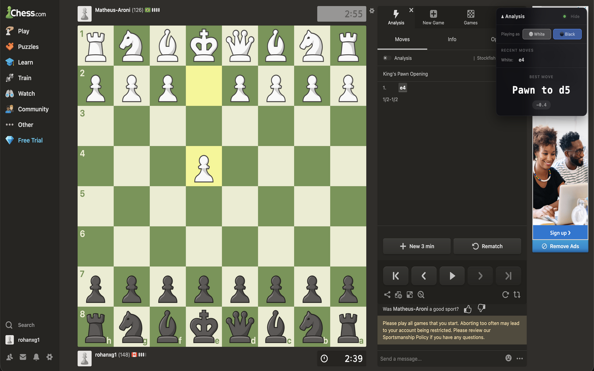
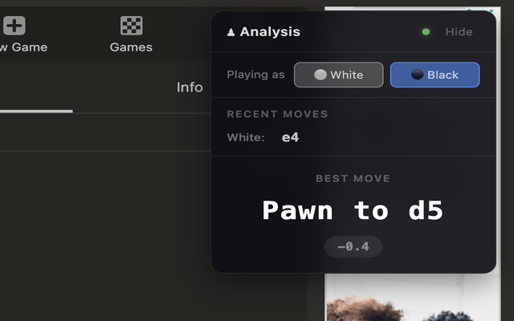
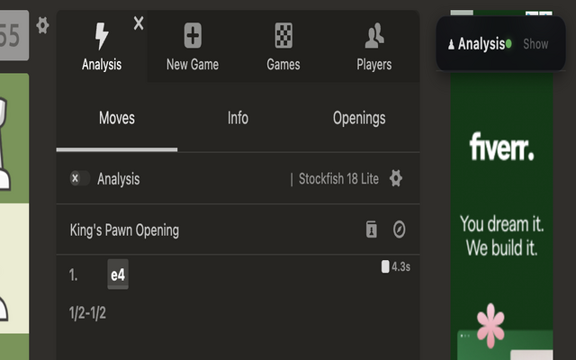
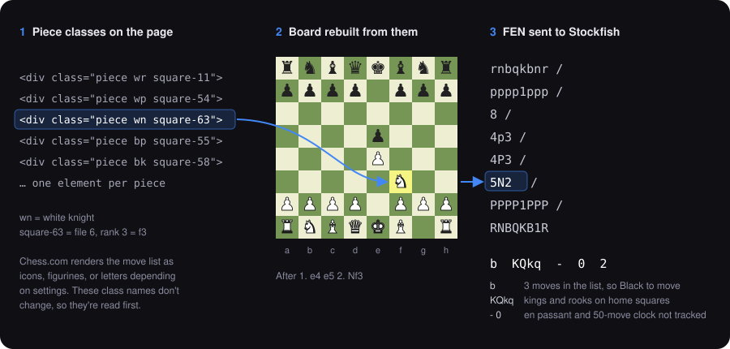

# Chess Real-Time Analyzer

<p align="center">
  
</p>

A Chrome extension that watches your game on Chess.com and shows what Stockfish would play, in a small panel beside the board. The engine runs inside the browser, so positions never leave your computer.

**[Chrome Web Store](https://chromewebstore.google.com/detail/ldejhoellmkjkojgnjmegbjahllohdmj)** · Chrome 116+

> Please don't use this in rated games. Engine help breaks Chess.com's fair-play rules and gets accounts closed. It's meant for bot games, casual games, and going over your own play.

## Using it

Open a game and tell the panel which side you're on. When it's your move, it shows the best move in plain words ("Knight to f3" rather than `g1f3`), the evaluation, and the next two candidates. On your opponent's move it waits. Press `H` to fold it out of the way.

<table>
  <tr>
    <td width="60%"></td>
    <td width="40%"></td>
  </tr>
  <tr>
    <td><sub>Playing Black after 1. e4. Scores are from your side of the board.</sub></td>
    <td><sub>Collapsed with <code>H</code>.</sub></td>
  </tr>
</table>

## How it reads the board

Chess.com doesn't offer an API for a game in progress, so the extension works out the position from the page itself. Every piece on the board is a `div` whose class names give its color, type, and square. That's enough to rebuild the board and write it out as a FEN string, which is the format chess engines take as input.

<p align="center">
  
</p>

Some things can't be seen on the board, so they're worked out instead. Whose turn it is comes from counting the moves in the move list. Castling rights come from checking whether each king and rook is still on its starting square.

### When the board can't be read

As a fallback, the extension replays the move list from the start. Scraped move text is messy. Clocks, move numbers, and check marks get mixed in, and if the move list draws pieces as icons, the piece letter disappears entirely. Each token is cleaned, then matched against the legal moves in the position:

```
on the page        cleaned    how it's resolved
──────────────     ───────    ──────────────────────────────────────────
"1. e4"            e4         plain SAN
"Nf3 0:42"         Nf3        clock stripped
"♘xe5+"            xe5        icon lost, so: whichever legal capture lands on e5
"Rxd4!?"           Rxd4       annotation stripped
"fd2"              fd2        the piece on the f-file that can reach d2
```

To see how well this is working on the current game, run `__chessAnalyzer.runParseCheck()` in the DevTools console. It reports how many moves were replayed and lists any that couldn't be matched.

## Running Stockfish in an extension

Stockfish runs in a Web Worker, but a Manifest V3 background script can't create one. The extension gets around this by having the service worker open a hidden [offscreen document](https://developer.chrome.com/docs/extensions/reference/api/offscreen) whose only job is to host the engine. Positions go from the page to the service worker to the offscreen document, and the top lines come back the same way.

The engine looks at three lines at once and searches to depth 12. It answers early, as soon as all three lines reach depth 8, so the panel keeps up with blitz. Every request is numbered, and an answer arriving after the position has already changed is thrown away rather than shown.

## What's in here

```
content.js      reads the board, builds the FEN, draws the panel
background.js   service worker; owns the offscreen document and passes messages
offscreen.js    hosts Stockfish in a Web Worker and parses its output
stockfish.js    Stockfish compiled to WebAssembly
chess.js        legal-move generation and FEN validation
overlay.css     panel styles
popup.*         toolbar popup that says whether the current tab is a game
```

It only asks for `activeTab`, `tabs`, and `offscreen`, and it only runs on `chess.com`.

## Running from source

Clone the repo, open `chrome://extensions`, turn on Developer mode, and choose **Load unpacked** on the folder. There's no build step.

## Known gaps

- En passant and the 50-move counter aren't in the FEN, so the engine can overlook an en passant capture.
- If a king or rook leaves its square and comes back, the extension still thinks castling is allowed.
- It depends on Chess.com's class names. If they redesign the board, the selectors need updating.
- Depth 12 is fine for practice but well short of full-strength Stockfish.

## Credits

[Stockfish](https://stockfishchess.org/) (GPL-3.0) via [stockfish.js](https://github.com/niklasf/stockfish.js) by Niklas Fiekas, and [chess.js](https://github.com/jhlywa/chess.js) by Jeff Hlywa.
